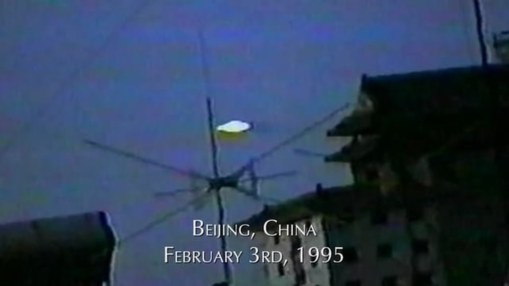
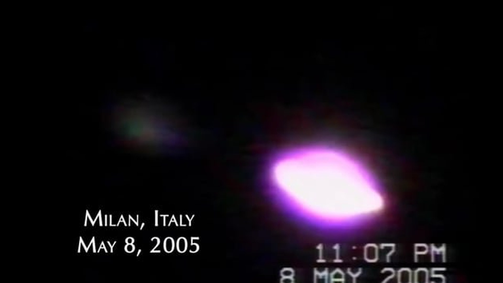
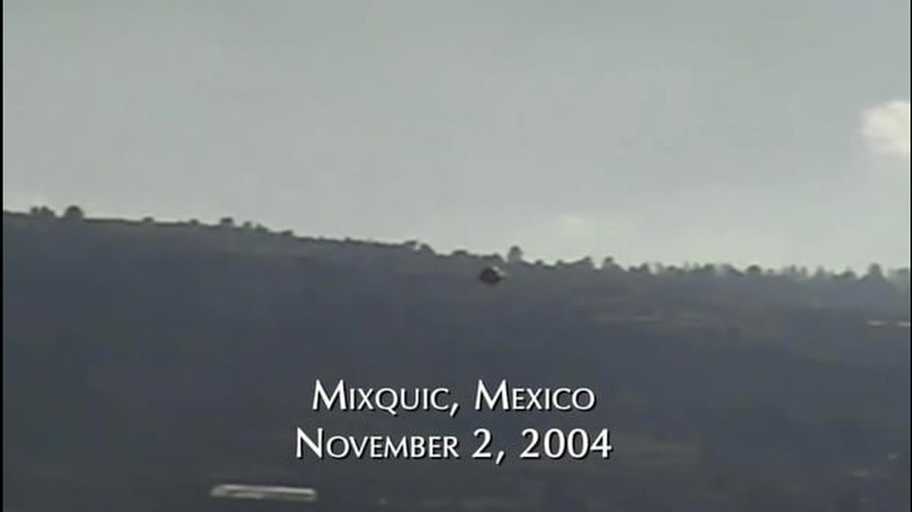
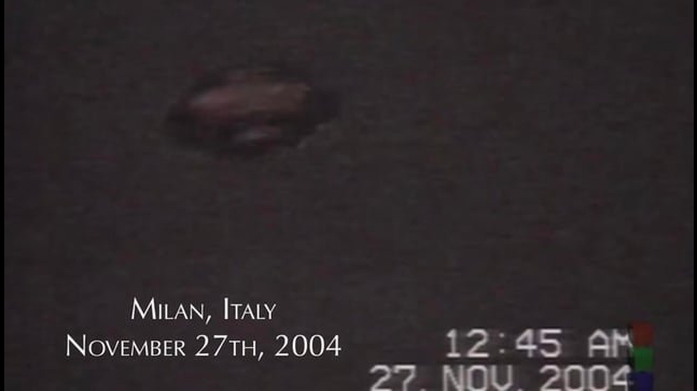

Beijing, China — February 3, 1995

Independent third-party paper. Not affiliated with CTP. Not an endorsement of CTP.

<b>Disclaimer — third-party materials:</b> CTP cites this work by Rizwan Virk with credit and acknowledgment for the quality of the report as it applies to CTP's technologies. CTP's use of these materials does not imply any endorsement of, or acknowledgment by, Rizwan Virk or his organization, and no working relationship exists between CTP and Rizwan Virk — neither party is working together with the other on this. CTP leaves open an invitation to collaborate, in the belief that humanity could move further ahead if we did.

The White Papers of the Sol Foundation · Vol. 2, No. 1 · Winter 2025

### Investment in UAP Technology and Ventures: Opportunities, Challenges, and a Way Forward

**By Rizwan Virk.** This white paper is about the challenges and opportunities in establishing an innovation ecosystem related to unidentified anomalous phenomena (UAP) — why investment in UAP-related ventures has been difficult, and a possible roadmap for expanding research and entrepreneurial activity around the scientific and technological advances that UAP could represent.

“The day before something is truly a breakthrough, it's a crazy idea.” — Peter H. Diamandis

##### Contents of the paper

1. Introduction and Executive Summary
2. A Brief History of Recent UAP Developments
3. The Unique Challenges and Opportunities of UAP — Science and Engineering Risk: Deep Tech Versus Frontier Tech · Historical Stigma in the Scientific Community · Secrecy and Security Concerns · The Unique UAP Opportunity
4. UAP Investment: Potential Opportunities — Origin and Observables · Specific Application Areas for Potential Investment (Aviation; Private Space Exploration; Communications and Control; Material Science; Maritime Applications; Defense Tech; Software, Data, and Instruments; Other Adjacent Areas)
5. Background on Innovation Ecosystems — The Importance of Innovation Ecosystems · Startup Funding for New Ventures in Silicon Valley
6. Structuring Investment and Building an Innovation Ecosystem for UAP — Stakeholders for UAP Ecosystem · A Multipart Investment Landscape (Research Funding; Innovation Prizes; Frontier Tech Incubator; Venture Capital Funding and Private Equity)
7. Conclusion: A Way Forward · About the Author · Notes · Bibliography

#### 1. Introduction and Executive Summary

UAP, previously known as UFOs (unidentified flying objects), have been the subject of increasing media coverage over the past few years, frequently in mainstream news outlets such as CNN and Fox News. This increasing exposure is the result of efforts of military and intelligence whistleblowers, members of Congress, prominent academics, journalists, and organizations like NASA. Recent media attention has led government officials to tacitly and sometimes directly acknowledge the presence of unidentified craft in US airspace and territorial waters.

Breakthroughs in UAP-related science and technology could revolutionize many of our existing industries, including aviation, space, defense, energy, medicine, communication, maritime operations, and materials engineering. Because of the wide potential of this technology, UAP represent an opportunity that could reshape the future of humankind as much as the development of the telephone, the automobile, the airplane, the rocket, or the personal computer.

While innovation was historically funded initially by government and wealthy patrons, this has evolved in modern innovation ecosystems, the most visible of which is in Silicon Valley. Many of the largest companies in the world by market capitalization have been funded this way. This ecosystem includes institutional investors such as venture capitalists, research institutions like Stanford University, and established companies that provide both talent and exits for new startups. However, a mature innovation ecosystem is not only about capital, but also about providing roadmaps to entrepreneurs and investors who wish to participate in the process of founding new companies.

This white paper explores whether private investment in new startups, in conjunction with government and large corporations, could play a significant role in expanding research into and launching ventures and products based on UAP-related technology. Virk argues that rather than establish one type of funding or just one organization, a new innovation ecosystem needs to be established with multiple types of funding, multiple players, and multiple avenues for entrepreneurs and investors to support UAP-related research and product development.

However, UAP also present unique investment challenges that other emerging industries may not have faced. Despite strong interest in this subject within both the federal government and the general public, many in our scientific institutions and existing innovation ecosystems like Silicon Valley remain skeptical about the topic in general. This is because of a stigma long associated with UFOs. Furthermore, UAP-related technology may require not only investment in engineering of new products and technology, but also breakthroughs in our understanding of the physical world. This may require larger investments and more patient capital than typical venture capitalists — or even existing deep tech investors — have the appetite for. For this reason, Virk introduces the term **frontier tech** for technology ventures that simultaneously carry science, engineering, product, and market risks. Finally, the national security implications of UAP make this a sensitive area subject to overclassification and geopolitical concerns.

To date, efforts to understand UAP-related technology and science have primarily been limited to two extremes: (1) the government relying on aerospace contractors in classified settings, or (2) isolated garage inventors and independent scientists with limited or nonexistent financial or institutional backing. To unleash the true power of entrepreneurship and market forces, this paper proposes unique investment models aimed not just at funding companies but at bringing the “best and brightest” minds to bear on the scientific, technical, and business challenges.

While the origin of UAP is an ongoing source of speculation, many UAP experts have determined that at least some of the reports cannot be attributed to prosaic sources such as balloons, seagulls, or hallucinations. In official congressional hearings, witnesses have stated under oath that some UAP appear to be actual technology, which may not be from human sources or adversaries such as China or Russia. The observables — summaries of the unusual performance characteristics of some UAP (such as instant acceleration, antigravity, etc.) compiled by Department of Defense (DOD) and intelligence officials in these programs — seem to imply that they represent technology leaps and bounds over our current technology. While this has led to more exotic theories for UAP (namely those that involve a nonhuman intelligence, or NHI, presence on Earth), this paper doesn't attempt to choose from different theories of the origin of UAP. Rather, it takes the position that if the reported observables are valid, even for some small fraction of UAP, then they represent significant technoscientific innovations.

Such innovations, which are not part of the public discussion of mainstream scientists or aerospace engineers, could revolutionize several industries and usher in a new type of industrial revolution. However, this will require not just funding but an innovation ecosystem around UAP-related research and ventures. More specifically, this white paper explores the challenges and opportunities of building such an ecosystem by attempting to answer the following questions:

1. What are the general areas of potential private and public investment in research and development related to UAP technology?
2. What industries could be affected or revolutionized by these investments?
3. What makes investment in UAP research and new ventures difficult?
4. Who are the stakeholders that could influence and participate in such an ecosystem?
5. What structure could work best for encouraging both research and entrepreneurial activity?
6. What actions could be taken in the short term, medium term, and long term to build such an innovation ecosystem?

To answer these questions, this white paper proposes several interlocking segments of investment to build a well-rounded UAP innovation ecosystem. This structure seeks to provide opportunities for existing stakeholders, such as departments of the government and large aerospace companies, to participate. More importantly, it seeks to build a UAP ecosystem that includes and encourages individual entrepreneurs, professional scientists, private and public research institutions, garage inventors, citizen scientists, and private investors. The four proposed segments of investment are:

1. **Research Funding.** Initially, this would be via a clearinghouse to connect UAP research funds from public and private sources to researchers. Then, long term, this would expand available research funding through the creation of one or more UAP research funds and/or UAP research institutes.
2. **Innovation Prizes.** A new UPRIZE, modeled after the innovation prizes of the early nineteenth and twentieth centuries, combined with aspects of the more recent XPRIZEs such as the Google Lunar X Prize and the Ansari X Prize, would allow for expansion of investment in private ventures through a multiplier effect.
3. **Frontier Tech Incubator.** Virk refers to this model as a halfway house that provides both resources (science labs) and patient capital to encourage technoscientific innovation, positioned between pure research and normal industry commercialization funds.
4. **Venture Capital and Private Equity.** With the establishment of the previous three segments, this should allow existing venture capital and private equity funds to participate in UAP technology ventures without the stigma or risks that currently exist.

In more practical terms, the goal of these segments, beyond establishing a UAP innovation ecosystem, is to provide roadmaps for key stakeholders, such as investors and entrepreneurs, who may not have clear guidance on how to engage with the UAP topic.

While the challenges to innovating and commercializing UAP-related technology are significant (and may even seem insurmountable in the short term), by taking a longer-term view, we can discern that they may be no greater than the leaps achieved in modern times. For example, a human of 1860, offered a glimpse of today's everyday technologies — such as self-driving automobiles, powered flight via jet engines, reusable rockets, genetic engineering, and computers — might also conclude that the challenges to achieve such a future are insurmountable. For this reason, Virk takes the position that the opportunity represented by investing in UAP research and development is not a short-term prospect. By taking a long-term view, investment in this topic in the coming years and decades could not only revolutionize life on Earth but also represent humanity's best hope of eventually becoming a multiplanetary species. This vision relies on going beyond existing methods of propulsion and lift, such as rocket engines.

#### 2. A Brief History of Recent UAP Developments

In the landmark *New York Times* story from December 2017, it was revealed that the Department of Defense had been studying UAP in secret programs, authorized and funded by Congress, including the support of then–Senate Majority Leader Harry Reid. Today, we know these programs have been both formally and informally named the Advanced Aerospace Weapons System Application Program (AAWSAP) and the Advanced Aerospace Threat Identification Program (AATIP). Since then, often based on the legislative requirements of Congress, the DOD has established a number of additional groups to study UAP. These groups included first a recent task force, the UAP Task Force (or UAPTF) and then a new office for tracking reports of UAP, the All-Domain Anomaly Resolution Office (or AARO).

In 2022, Congress held the first hearing on UAP in fifty years. In more recent hearings in 2023, some of our top fighter pilots testified under oath to the flight characteristics of and evidence for unusual aircraft they encountered. Their testimony revealed that these unidentified craft had been seen both visually and on instruments, including various types of radar and infrared cameras. They also testified that these aircraft could outperform anything in the public US arsenal at the time. Unclassified videos of some of these encounters were leaked at the time of the 2017 *New York Times* article and were later validated as authentic videos from the DOD, though there has been considerable debate in the years since about what is shown in the videos.

In both the recent congressional hearings in 2023 and 2024, high-ranking former intelligence officials claimed under oath that the US government had recovered “crashed craft” made by nonhuman intelligence. The recovered UAP materials, officials report, were stored in unacknowledged special access programs and were the subject of reverse engineering efforts conducted within leading aerospace companies. Most important from a congressional point of view, these programs were concealed from the legislative branch. These reports have led the Senate, spearheaded by Senators Charles Schumer and Mike Rounds, to draft the UAP Disclosure Act into the National Defense Authorization Acts (NDAAs) of 2023 and 2024. The language in these official government documents included, for the first time, formal definitions for NHI (nonhuman intelligence) and TUO (technology of unknown origin) in congressional legislation. The bills also referred to the reverse engineering programs of crashed craft, as well as nonhuman biological remains.

Lost in the media attention has been the fact that while there is no consensus among researchers about what these UAP are or who created them, there is a general consensus among UAP researchers that UAP most likely represent technology that is more advanced than what is being produced today by our scientific, government/defense, and private institutions. In other words, UAP represent breakthrough technology. Newly appointed AARO Director Jon Kosloski told Defense Scoop in November 2024 that the general definition of breakthrough technology is “beyond state-of-the-art today, and beyond where we think that we could get in the next couple years.” Kosloski also described a smaller group of unexplainable reports that AARO was set up to investigate, which he called “truly anomalous” — cases that he, with his physics and engineering background and time in the Intelligence Community, does not understand, and doesn't know anybody else who understands.

This corresponds with reports from US fighter pilots describing truly anomalous events that exhibited technology described as “not of this world” by one pilot, and technology “that outstrips our arsenal by at least 100 to 1,000 years at the moment,” according to another. Former Director of National Intelligence John Ratcliffe stated to Fox News: “When we talk about sightings, we're talking about objects that have been seen by Navy or Air Force pilots, or have been picked up by satellite imagery, that frankly engage in actions that are difficult to explain, movements that are hard to replicate, that we don't have the technology for or traveling at speeds that exceed the sound barrier without a sonic boom.”

Scientists in academic and public institutions, which formerly shied away from UAP, have begun to show an interest in doing scientific research in this area. Kevin Knuth, a physicist from SUNY Albany, coauthored a 2019 paper, “Estimating Flight Characteristics of Anomalous Unidentified Aerial Vehicles,” in which his team estimated that the object encountered by the Nimitz carrier group in 2004 exhibited “accelerations ranging from almost 100g to 1000s of gs with no observed air disturbance, no sonic booms, and no evidence of excessive heat commensurate with even the minimal estimated energies” — concluding that either these estimates were entirely fabricated or “these craft exhibit technology far more advanced than any known craft on Earth.” One of several academic research projects set up in recent years is Harvard's Galileo Project, established by astrophysicist Avi Loeb in 2021. The Sol Foundation, cofounded by Stanford professor Garry Nolan, anthropologist Peter Skafish, and AI entrepreneur Jonathan Berte, held its first conference at Stanford in 2023. On the government research side, NASA formed a preliminary task force to examine aspects of the UAP issue in 2023, including highlighting the need to deal with existing stigma around researching this topic.

#### 3. The Unique Challenges and Opportunities of UAP

In the short term, many official and unofficial public scientific initiatives are focused on collecting and analyzing more data on UAP. In the medium to long term, a larger number of research initiatives can and should turn to the question of what kind of breakthrough technology could produce the anomalous characteristics of UAP. This will lead to opportunities for investment in both scientific research projects and technology ventures that could expand our knowledge of physics, engineering, and materials science, as well as revolutionize many industries. The goal of this research should be to understand the principles behind the seemingly impossible performance characteristics of UAP, including lift, control, and acceleration — including how technology that could reproduce those principles might be built, and the materials and engineering expertise required, for example, to build craft that could accelerate at 10 to 100 gs or move from deep beneath the ocean to outer space, all within an environment that could support human life.

If the technology can be mastered and its underlying principles understood and reproduced, this could not only be lucrative for investors but, depending on the nature of the technology, also alter the future trajectory of humanity. This is true regardless of the actual origin of UAP technology and whether top-secret, clandestine reverse engineering programs already exist, as claimed by multiple whistleblowers. Yet this preliminary interest is tempered by the many challenges that are unique to UAP: a lack of understanding of how UAP work, how to reproduce the capabilities shown by UAP, the stigma that accompanies the subject among academic scientists, and the obvious national security implications of doing such research.

##### Science and Engineering Risk: Deep Tech Versus Frontier Tech

At first glance, it might seem that UAP investments might naturally fit into the sector called “deep tech.” Deep tech has become established over the past decade as a legitimate sector of the venture capital (VC) / startup landscape, though it requires more patience than many ordinary VC investments. According to researchers from the MIT Sloan School, deep tech refers to those ventures that are grounded in science and technology but require innovations to come to fruition. The term was coined in 2015, partly to contrast these ventures with those that simply rely on existing technology, such as software development or new hardware built on existing components, which are now often called “regular” or “shallow” tech. Deep tech ventures have the “potential to dominate the future in many ways.” From a financial perspective, deep tech companies require significantly larger investments than a typical Silicon Valley technology company, and significantly longer timescales before a product can be brought to market. In the last decade, according to the Boston Consulting Group, deep tech has grown to constitute 20 percent of all venture capital funding. Examples of deep tech funds include SOSV, Cottonwood Technology Fund, DCVC, Lux Capital, and The Engine (launched out of MIT). Another well-known example is the EIC (European Innovation Council) Fund, part of Horizon Europe. Perhaps the two most famous examples of deep tech ventures are SpaceX and Tesla: while both required technoscientific innovation, they focused more on product R&D and product engineering than advancing fundamental understanding of the physical world, using known principles of rocketry, electricity/energy, manufacturing, and software.

Though the category of deep tech seems to fit potential UAP ventures as well, there are subtle and not-so-subtle factors that make UAP-related opportunities difficult, even for existing deep tech funds. An important challenge is that the basic science and engineering of how the craft work is not fully understood. While deep tech investors aren't afraid of engineering challenges, consider SpaceX: the basic principles of rocketry did not need to be reinvented for the venture to be successful, even though significant engineering was necessary to create reusable rocket boosters. UAP-related ventures — particularly those needing significant breakthroughs — might require even more funding and time to mature than currently popular deep tech sectors such as clean energy, defense tech, quantum computing, advanced AI, and private space exploration.

For this reason, Virk classifies the UAP segment for investment as **frontier tech**: funding for ventures that lie outside the bounds of what is understood or known to be possible. The three types of risk that characterize the differences between these segments are:

1. **Market Risk (Shallow Tech):** Will the company's product succeed in the market?
2. **Engineering/Product Risk (Deep Tech):** Will the company be able to build a functional product in a reasonable amount of time?
3. **Science Risk (Frontier Tech):** Is it even possible to build the product, given what we know about physical science and materials science?

While shallow tech VCs typically expect a product within five years and focus on market risk, deep tech VCs are more speculative and willing to take on both market risk and engineering/product risk. Frontier tech investors and funds, however, would need to provide even more patient capital, including significant research capital — taking on not only market and engineering risk but also scientific risk. More recent scholars of innovation have used the term “technoscientific research and innovation” to describe the mixing of scientists and engineers to try to solve particularly thorny problems while building new products.

##### Historical Stigma in the Scientific Community

One of the unique challenges with UAP is that many scientists and investors dismiss the subject as “fringe” or a “conspiracy theory,” often unaware of how seriously the US government is taking the subject and the recent developments in the field — the quality of witnesses, the multimodal evidence for such advanced technology (in encounters such as the Nimitz encounter in 2004), and congressional attention from prominent senators like Chuck Schumer and Marco Rubio, along with the resulting legislation. This existing stigma and general ignorance on the topic have led to skepticism that UAP technology exists or is even possible. Such an attitude frequently precludes serious consideration of funding for research that could explain or lead to the development of technology that could reproduce the behavior of UAP.

Moreover, investors usually rely on technical and scientific experts to validate the feasibility of a new technology before making an investment decision. The fact that UAP may represent breakthroughs that are not accounted for in our current understanding of physics, materials, and engineering practices makes it difficult for these standard experts to validate any UAP-related research or product.

The stigma in the scientific community has built up over decades since Project Blue Book, which ended in 1969 after claiming that UFOs were not a threat to national security. The shutdown was supported by the Condon Report, a panel of scientists hired by the government and led by University of Colorado physicist Edward Condon, which publicly concluded that nothing had been learned from the study of UFOs. In reality, many key scientists who were intimately familiar with the topic objected to the report's conclusions, such as J. Allen Hynek, chief astronomer at Northwestern University and the scientific consultant for the Air Force's Project Blue Book; James McDonald, a respected atmospheric scientist from the University of Arizona; and Peter Sturrock, a professor of electrical engineering at Stanford University. The extraterrestrial hypothesis is perhaps most associated with the stigma: the term “UFO” and its affiliation with “little green men” and other fringe topics is perhaps the most common reason many academics and scientists have shied away from or even ridiculed the field. The stigma also exists, as Virk found in his academic research, because of its association with the paranormal and other subjects regarded by scientists as disreputable, including the topic of “alien abductions,” which became common in the 1990s with the popularity of shows like *The X Files*. In 1992, a conference was held at MIT, cochaired by MIT physicist David Pritchard and attended by John Mack, former chairman of the psychiatry department at Harvard Medical School; a few years later Mack wrote a bestselling book about the phenomena, and both the conference and the book caused a media firestorm, resulting in both MIT and Harvard attempting to distance themselves, as well as a disciplinary hearing for Mack.

However, since the 1960s, scores of serious researchers have emerged, both inside and outside academia (sometimes referred to as the “Invisible College”). Today, academics from diverse fields — including physics, astrophysics, anthropology, political science, biology, philosophy of science, and religious studies — are openly researching the subject, as shown by their representation in the Sol Foundation's conferences. Through the efforts of former government officials, current members of Congress, and pioneering academic visionaries and projects, the stigma around UAP is already lessening. Within scientific research and technology investment, there are many examples of areas that were previously stigmatized or thought to be dead ends, which eventually became popular areas for research and investment: AI research, quantum computers, DMT and other psychedelic-based therapies, and nuclear fusion research. The purpose of this white paper is to show how the same can happen for UAP-related research and products.

##### Secrecy and Security Concerns

Another major concern related to UAP investments is that the reported phenomena overlap with national security issues and geopolitical considerations. Multiple witnesses and whistleblowers have asserted that, despite claiming to have left the “UFO business” at the end of 1969, the US government continued to operate covert programs investigating UAP sightings well into the twenty-first century, including AAWSAP and AATIP, and potentially other programs whose names have not yet been made public and remain top-secret. Reports of unidentified craft flying around the nation's airspace without permission or restriction, including over its most sensitive sites — Air Force bases and even nuclear missile silos — obviously have national security implications, as do reports of UAP activity in the oceans and over the nation's territorial waters.

There have also been reports, including in sworn testimony to Congress, that certain US aerospace defense companies have already been working to reverse engineer recovered UAP technology given to them by the US government. These programs are alleged to be locked away in SAPs (special access programs) and housed inside the same large aerospace contractors responsible for building the nation's most sophisticated weapons systems. This raises the possibility that UAP technology, if it exists, is highly classified. The national security concerns include:

1. The ability of foreign adversaries to leapfrog the United States by investing in and perfecting UAP-related technology.
2. Noncooperation by existing aerospace entities because of existing secrecy.
3. The issue of eminent domain.
4. The issue of national security patents.
5. Legal considerations of liability for hiding programs from congressional oversight.
6. Issues related to national energy policy and geopolitical strategy and alliances.

In Virk's own interviews with individuals who worked in government-related UAP programs, the most significant reason cited for the secrecy is the first one: the fear that while UAP represent a significant leap over our best publicly acknowledged technology, an adversary such as China or Russia could, by exploiting such knowledge, leapfrog the defense capabilities of the United States and other Western governments. Another concern relayed to him was that if a private organization was getting close to reproducing characteristics of critical UAP technology, the patents could immediately be seized by the US government and would no longer be owned by the company, which could be a damper on investment in the sector — a concern recently highlighted by Marc Andreessen, cofounder of Andreessen Horowitz, who said government officials told him the government could classify whole areas of science, including math and physics.

##### The Unique UAP Opportunity

Nevertheless, these security concerns assume that we might be getting near the point where current scientists and engineers not only understand the principles behind how UAP technology could work but also have the expertise to reproduce it in the near future. Several insiders have claimed that while UAP represent advanced technology and there are classified reverse engineering programs, we have not yet been able to figure out exactly how the technology works or come close to reproducing it. Part of the reason for this white paper's recommendation to invest in more open research is so that we can close the gap in our public understanding of physics, chemicals, materials, and other sciences that might make implementation of such technology possible — by unleashing the minds of the “best and brightest” scientists and engineers in an ongoing process of technoscientific research and innovation.

As an instructive example, when the atom was split in late 1938, it took only a month before the term “fission” was coined, and papers were reviewed by luminaries such as Niels Bohr and validated by other scientists within months. The Manhattan Project itself was an example of focused technoscientific innovation: even if nuclear fission was understood and experimentally reproduced, it still took an entire cadre of Nobel-caliber physicists, chemists, and engineers to figure out how to build such a device. By comparison, the secrecy surrounding technoscientific UAP research programs in the government, if they exist, may be counterproductive: J. Robert Oppenheimer recalled that compartmentalization would slow down the process, which led to the establishment of the laboratory at Los Alamos, where theoretical ideas and experimental findings could affect each other. Decades of mentorship, scientific publications, reproduction of results, and cross-disciplinary collaboration were needed before the secrecy around the Manhattan Project was necessary, justified, or appropriate — and similarly, we may yet be in the stage where decades of research and collaboration between scientific minds are needed before we are ready to produce full-blown craft that can reproduce all the characteristics observed in UAP.

While such national security considerations are part and parcel of the UAP issue, privatization is possible and often necessary for innovation, even in industries that involve national security. Privatization of space, including the launching of satellites, is a prime example of an area rife with national security concerns in the past that has already undergone privatization. This decades-long process resulted in new companies worth billions of dollars and entirely new industries that are projected to be worth trillions of dollars as the space economy grows. In a sense, all the special considerations related to challenges of UAP — unproven technology, large research and development cycles and budgets, historical stigma, and national security concerns — have all been present in varying amounts in previous industries (though not necessarily all in one industry). In the medium to long term, it will be possible to overcome these challenges and create a UAP innovation ecosystem through top-down initiatives involving government and public funding, as well as bottom-up, entrepreneurial, and investment activity from the private sector.

#### 4. UAP Investment: Potential Opportunities

##### Origin and Observables

From an investment point of view, it matters less whether we have nailed down the specific origin of the phenomena. What matters more is that the technology has been observed, and consistent characteristics have been reported that can be evaluated. In other words, what matters is that some UAP represent advanced technology, and this subset of UAP do not fit the prosaic hypothesis (they cannot be explained by balloons, conventional aircraft, atmospheric clutter, misidentifications of Venus, swamp gas, or mass hallucinations). The potential applications are the same, even if the technology originated from secret government advanced weapons projects (the classified hypothesis), outer space (the extraterrestrial hypothesis), an underwater or underground race of nonhuman entities on Earth (the Silurian or cryptoterrestrial hypothesis), deception by beings we associate with myth (as described by Jacques Vallée, among others), or even future humans traveling back in time (the extratemporal hypothesis).

These characteristics, observed by both civilians and military personnel, were summarized by Luis Elizondo, the former head of one of the Pentagon's UAP research groups (AATIP), who articulated the “observables” derived from seventy-five years of sightings. They are as follows:

1. **Hypersonic Velocity.** UAP have been observed at hypersonic speeds (Mach 5, or five times the speed of sound), and in many cases they exceed Mach 17 — from craft with no visible means of propulsion as we currently understand it.
2. **Instant Acceleration.** Accelerating in a straight line at speeds that would make G-forces unbearable for existing aircraft structures and human occupants, and also making instant turns and shifting direction with rapid acceleration.
3. **Low Observability.** The ability to have a low or no radar signature, as well as potentially disrupting existing electromagnetic forms of communication.
4. **Transmedium Travel.** The ability to go seamlessly from under the water to the air and into outer space.
5. **Antigravity.** Perhaps the most controversial observable: UAP have a method of lift (and possibly propulsion) that allows them to “counteract” gravity and inertia in ways we haven't yet been fully able to explain — alternatively characterized as gravity control.
6. **Biological Effects.** Government reports have revealed biological effects on those who have encountered a UAP up close, validated with the US government even issuing disability benefits to soldiers who experienced deleterious effects after proximity to a UAP. This category could also include potential beneficial effects on humans, including medical technology.

To emphasize the truly revolutionary potential of UAP-related technology, the Pentagon's previously secret UAP investigation program AAWSAP commissioned a series of thirty-eight scientific reports, called DIRDs (Defense Intelligence Reference Documents), from scientific experts at academic institutions and private research labs. A list of these documents, shared with Congress, was released in 2019 through a Freedom of Information Act (FOIA) request. These studies, commissioned in 2009, included such titles as “Traversable Wormholes, Stargates, and Negative Energy”; “Metamaterials for Aerospace Applications”; “Field Effects on Biological Tissues”; and “Invisibility Cloaking.”

##### Specific Application Areas for Potential Investment

Each of these application areas is highly speculative and would need either a short or long process of technoscientific innovation to be achieved. Still, each represents potentially large, almost transformative market opportunities for investors, public and private. The paper's summary maps industries to observables and time frames — short term (one to five years), medium term (five to ten years), long term (ten or more years): Aviation (observables 1, 2, 5 — medium term unmanned, long term manned); Private space exploration (1, 2, 5 — medium unmanned, long manned); Communications and control (medium term); Materials science (3, 4, 5 — short to medium term); Maritime applications (4 — short to medium term); Defense tech (1, 2, 3, 4, 5, 6 — medium to long term); Software, data, and instruments (short term); Other adjacent areas (long term).

**1. Aviation.** The ability to have hypersonic craft that go faster than Mach 17, with extreme maneuverability, is a natural fit for both civilian and military aviation. Existing technology might only achieve these speeds through rocketry and ballistic missile technology, which are not viable options for the mass transport of civilians or cargo — while UAP have been able to achieve such velocities within Earth's atmosphere. This application area would include mastery of so-called antigravity, or more specifically the synthetic creation of gravitation fields using electromagnetic fields. In the 1950s, aviation firms and academic research institutions launching gravity-control research programs weren't considered strange: institutions identified as conducting gravity-control research in late 1955 included Martin Aircraft Company, Lear Inc., General Dynamics, Sperry-Rand Corporation, Convair, and the Sikorsky division of United Aircraft, alongside scientists from Princeton's Institute for Advanced Study, Indiana University, and Purdue's Research Foundation, as well as the privately established Babson Gravity Research Institute. However, large companies are generally loath to cannibalize their existing products, so capitalizing on new aerospace products related to UAP will likely involve opening up research beyond secret government projects at very large defense contractors to involve innovative startups — and garage inventors, who have claimed to uncover and build prototypes of the propulsion and lift systems of UAP, should not be discounted: the Wright brothers perfected the first airplane in their bike shop. Far-future startups and spinoffs could create UAP-type engines, antigravity modules for private craft and the transportation industry, parts and material providers, and companies specializing in new manufacturing processes for metamaterials.

**2. Private Space Exploration.** Within the past decade, the privatization of space has occurred very quickly, launching many new multibillion-dollar ventures. UAP have been observed to be “transmedium” craft capable of going seamlessly from under the ocean to the atmosphere and into outer space using unified propulsion and possible life-support methods. Today, the space industry is based primarily on rockets lifting items into orbit — a relatively inefficient way to deliver items. Serious investment in UAP research is likely to create different methods of lift capable of operating beyond the atmosphere, enabling the transportation of satellites initially and, eventually, human crews into outer space without the use of inefficient rockets. Even more futuristic applications may be unlocked, such as the equivalent of space elevators, space tourism at a fraction of current cost, and large-scale solar system colonies, which may require entirely new technology — UAP research and gravity control may be one of the paths to allow such mass migration and travel in space.

**3. Communications and Control.** Reports of the communications and control systems for UAP often involve new types of BMIs (brain-machine interfaces) or BCIs (brain-computer interfaces), in which the pilot can operate the craft without a traditional set of flight controls. Many reports, including the Nimitz Tic Tac encounter, suggest the UAP was able to anticipate what the pilots in our aircraft were going to do and adjust accordingly. BCIs such as Neuralink have already allowed one quadriplegic individual to play video games, with more human testing in progress. It is possible that UAP can also communicate over large distances utilizing quantum entanglement or other, not-yet-discovered methods; research labs are already experimenting with quantum teleportation. The study of UAP could provide a significant jumpstart to each of these areas, including novel communications between submarines, the surface, and outer space.

**4. Materials Science.** Underlying many potential areas of UAP investment is the new materials science that may be required to build these novel applications and systems. Analysis of existing material purported to come from UAP has revealed extremely precise arrangements of existing known terrestrial elements in what are often publicly called “metamaterials.” For example, when TTSA (To the Stars Academy), in conjunction with the DOD itself, analyzed a purported metallic fragment from UAP, the structure was revealed to comprise layers of magnesium, zinc, and bismuth — clearly engineered with distinct layers of MgZn and Bi at structured thicknesses only microns thick, with no precedent for this structured combination, acting as a waveguide for terahertz (THz) frequencies. In a scientific paper accepted by the journal *Progress in Aerospace Sciences*, Garry Nolan, Jacques Vallée, and colleagues outlined methods for studying an unknown material, including elemental and isotopic analysis, and gave an overview of analyzing metallic material found at the location of a UAP sighting in Council Bluffs, Iowa. Research in this area may lead to entirely new types of materials and manufacturing processes specifically engineered for use in these craft, analogous to how carbon fiber manufacturing led to lightweight yet extremely durable materials used in certain aircraft.

**5. Maritime Applications.** One of the main reasons the acronym changed from UFO to UAP (unidentified anomalous phenomena) came from the “transmedium” capabilities of UAP, confirmed across numerous observations by the United States' and other countries' navies as well as the crews of international shipping companies. Some reports are of UAP traveling underneath the ocean and then rising from there into the atmosphere; maritime sightings include the tracking by sonar of large underwater objects (USOs — unidentified submersible objects) traveling at remarkably high speeds. This raises the potential for entirely new maritime applications, moving beyond existing submarines and transportation systems, for shipping, passenger transport, resource extraction, storage and management, and perhaps even underwater bases and cities. (See the Sol Foundation white paper “Beneath the Surface: We May Learn More About UAP by Looking in the Ocean.”)

**6. Defense Tech.** In recent years, investment in defense tech has grown significantly: according to Crunchbase, in both 2022 and 2023 the amount of venture capital investment in defense tech companies was over $2 billion, and 2024 was shaping up to hit new highs. Prominent companies in this field include Palantir and Anduril. The fact that UAP are being investigated by the Department of Defense and intelligence agencies underscores the national security issues and potential applications involved, and some officials believe a secret arms race around UAP technology is already underway. UAP have been sighted over the nation's most sensitive installations, including nuclear missile sites, with reports of the ability to not only deactivate but also reactivate nuclear-tipped ICBMs. Entirely new defensive and potentially offensive weapons are a natural application of UAP technology: the ability to travel at hypersonic speeds with precision, while maintaining low observability (stealth), may result in new categories of defense applications. This area is fraught with difficulties — overclassification, seizure of patents, interagency turf wars, and geopolitical rivalries — but defense tech investors in particular should encourage UAP-related research and take such applications as seriously as the government does.

**7. Software, Data, and Instruments.** While many potential areas of investment require more basic research before commercial products can be designed, there is already a potential market for using AI to collect, store, and analyze data related to UAP reports — from existing databases such as MUFON, classified databases, or new reporting apps like Enigma used by consumers. There are also instrumentation ventures and projects, including private projects to create observation tools, efforts like UAPx, and fully academic projects like the Galileo Project at Harvard, whose members aim to have mini “observatories” spread out across the country and utilize AI to analyze the data. There is also the possibility for private satellites to look for and track UAP. AARO has already engaged with research institutions to help build better sensors and enhance data analysis, identifying its efforts to deploy GREMLIN, a prototype suite of sensors built in conjunction with the Georgia Tech Research Institute. Companies like Slingshot Aerospace, which use sensor networks to track satellites and other objects in Earth orbit, have already raised over $80 million for database and simulation products. These ventures represent shorter-term opportunities for consumer data and reporting, as well as new kinds of scientific instruments optimized to look for UAP in optical, infrared, radar, and other frequencies.

**8. Other Adjacent Areas.** The most prominent of these include new energy technologies. The energy generation and storage requirements to accomplish the observables may be significant enough to require entirely new ways of generating energy. There have been reports from garage inventors and UAP witnesses that the technology needed for antigravity craft could also be used to generate zero-point energy; Hal Puthoff and Eric Davis, two scientific consultants for the AAWSAP and AATIP efforts, have produced papers on these ideas. Energy represents a potential large area for investment and overlaps with deep tech investments in clean energy and other speculative areas such as contained fusion reactions. Other industries that could be affected in the long term include the biotech and medical fields.

UAP technology that could reproduce the observables has the potential not only to incrementally add to existing industries but to completely revolutionize them. Funding UAP technology should be considered investment in frontier tech that could produce breakthrough products and companies. Many of these applications are not in the “productization” phase yet because more research needs to be done — but this was also the case for many of today's industries, where the core technology was once held by the government or inside large corporate R&D labs and considered futuristic.

#### 5. Background on Innovation Ecosystems

During the past century, significant new innovative industries have been formed through collaborations between governments, academic research institutions, and private investors/entrepreneurs. Both the research and product development were funded initially primarily through wealthy patrons and informal networks of what we might call “angel investors” today. Collaboration of these elements has resulted in the development of the Internet (originally funded by DARPA), artificial intelligence, commercial aviation (funded almost entirely by the US Postal Service), private space vehicles, biotechnology, infrastructure for automotive, nuclear energy, and nanotechnology. In recent decades, private investment in startup technology companies has come to represent a much larger percentage of innovation and new company formation, best represented by the entrepreneurial and venture capital ecosystem in Silicon Valley. A mature innovation ecosystem provides not only capital but also assistance and support to potential entrepreneurs and fledgling startup ventures by providing educational, mentoring, and strategic resources.

##### The Importance of Innovation Ecosystems

A modern innovation ecosystem that encourages new startups to capitalize on research and build new products, turning scientists and engineers into entrepreneurs, consists of several interrelated categories of individuals and institutions:

- **Entrepreneurs/Founders** — the heart and lifeblood of innovation ecosystems; founders usually come from the other parts of the ecosystem.
- **Research** — existing institutions where research is done (Stanford University or MIT), R&D centers of existing large companies, or private organizations set up specifically for R&D.
- **Talent (from Mature Companies)** — experienced talent in engineering, marketing, and operations provided by existing large companies.
- **Angels and Mentors** — individuals who have been successful in previous ventures, who become mentors, advisors, and pre-seed-stage (angel) investors.
- **Professional Investors** — venture capital (at various stages) and private equity (for later-stage companies).
- **Service Providers** — legal, marketing, and infrastructure providers who offer flexible terms to early-stage, high-growth companies.
- **Educational and Accelerator Programs** — purely educational programs or commercial accelerators or incubators, such as Y Combinator or 500 Startups.
- **Exit Providers (Mature Companies)** — exits are when startup founders and investors sell the company; the money earned is recycled toward funding new ventures.

The most important segment is entrepreneurs/founders of companies. Innovation ecosystems have historically grown up around geographies that fostered certain industries to maturity, but Silicon Valley is an innovation ecosystem that has survived many decades of innovation — the term “Sand Hill Road” now refers to venture capitalists in general, analogous to how “Wall Street” no longer refers specifically to a street in New York City. Unlike the aerospace or automotive industries, there has been a high tolerance for failure in Silicon Valley, which has remained part of the culture: a failed venture does not signify the end of an entrepreneur's career. This is often why many governments that attempt to replicate a high-tech innovation ecosystem are unsuccessful — they lack this tolerance for failure and the recycling of money and advice from successful founders and early employees.

##### Startup Funding for New Ventures in Silicon Valley

Startup funding within an ecosystem often follows a similar structure, which sets a clear course for both entrepreneurs and investors and sets expectations on risks and valuations:

- **Research.** Often the original research that led to the idea for the company was done within an institution — an educational institution like MIT or Stanford, or an R&D lab within a larger organization — funded by government programs through organizations like DARPA and the NSF, contracts with existing companies, or private foundations. Through the Small Business Innovation Research (SBIR) and Small Business Technology Transfer (STTR) programs, the federal government provides funds or technology to startups to advance and commercialize their research.
- **Pre-Seed.** Usually the first stage of investment after a startup has been formed; the company may not have anything but an idea, or it may have intellectual property licensed from prior research. Traditionally the money has come from friends, family, and angel investors; startup studios, incubators, and accelerators (Y Combinator, 500 Startups) provide both education and several hundreds of thousands of dollars. Even capital-intensive deep tech ventures, such as aerospace companies, have participated in accelerators — Boom Supersonic was part of Y Combinator.
- **Seed.** Seed rounds today can range anywhere from $1 million to $5 million (or more). By the end of this stage, shallow tech companies should ideally have a product ready to be sold with some indication of market demand; capital-intensive deep tech products might consist only of preorders based on a scaled-down or working prototype, a working demo, and promises.
- **Product and Market (Series A and B).** Funding rounds almost always led by a professional venture capital investor or institution. The company is scaling up its management team, sales and distribution infrastructure, marketing, and/or manufacturing. Each round is meant to reduce risk — removing product risk, reducing market risk, and reducing execution risk — so each series round is larger than the previous one and the valuation grows. At Series A, the company typically secures enough funding to launch its commercial prototype or beta product and shows some amount of traction.
- **Late Stage (Growth).** Private investment funding rounds beyond Series B are taken up by larger private equity funds that invest significantly larger amounts, from tens of millions to hundreds of millions (and in some cases billions) of dollars. Venture capital funds look for a return of ten to one hundred times their initial investment in successful ventures, because a large percentage of their investments fail; late-stage growth funds generally look for perhaps two or three times their initial investment when the company reaches an IPO or gets sold to a larger public company.
- **Exits.** A sale of the company might happen at any stage, or it might go public in an IPO. After the financial crisis of 2008, most startup exits became acquisitions rather than IPOs. The importance of exits to an innovation ecosystem shouldn't be underestimated: it's the money from exits that fuels pre-seed investment, such as angel funding for new companies and new venture capital funds, while letting existing investors recoup their investments and recycle their money into new opportunities. There is also the acqui-hire, in which a company, despite failing commercially, is acquired by a larger organization for its talent.

The importance of these roadmaps can't be overstated, for both investors and entrepreneurs in an innovation ecosystem. They are common standards that both sides know about and expect will be adhered to. Without these expectations, a garage inventor might expect their new innovation to raise $100 million off the bat, with a valuation of $1 billion — extremely unrealistic expectations.

#### 6. Structuring Investment and Building an Innovation Ecosystem for UAP

To build a full innovation ecosystem around UAP will require multiple funding methods, research approaches, and the involvement of myriad individuals and organizations, going beyond simply funding new startups. This includes several interlocking segments of investment, meant to serve various groups of stakeholders that could participate in such an ecosystem. The power of an ecosystem is only unlocked by fostering multiple paths, involving various parties, and harnessing collaboration, competition, and market forces at the appropriate stages of the process.

##### Stakeholders for UAP Ecosystem

The stakeholders begin with the lifeblood of any innovation ecosystem — researchers/scientists/experimentalists and entrepreneurs/founders — who might emerge from:

1. Garage inventors who have come up with a novel device or technology that replicates UAP.
2. Entrepreneurs (nontechnical) with visions for new applications, who might partner with technical founders and researchers.
3. Scientists in academia who would like to conduct more research on UAP technology to understand how the observables might be achieved.
4. Independent researchers who have developed theories and experiments about how UAP technology may work, but do not currently have access to laboratories and funds.
5. Students in academia who are working in the physical sciences and would like to do research on UAP principles but are discouraged by existing stigma and lack of funding.
6. Government scientists who have been exposed to frameworks, technologies, and applications in the legacy program and are frustrated by the lack of progress or commercial applications.
7. Engineers and executives from large aerospace and biomedical companies who may have been exposed to the legacy programs or materials, or who would like to develop new technologies based on emerging principles.
8. Employees of large organizations (aerospace, pharma, biomedical, or other) who have had no exposure to legacy UAP programs but see opportunities and need funding for experiments to create breakthrough or next-generation technologies and applications.

Institutional stakeholders include private foundations that wish to fund UAP research, government science organizations, the Department of Defense, large aerospace companies, venture capital funds, wealthy angels / individuals / family offices, universities, and private research organizations and labs. These stakeholders should have a way to participate as investors, grantors, grantees, customers, and in other capacities. Given the diverse set of interests, there must be not just multiple funds but also multiple types of capital operating at different stages, including grants, contracts, nondilutive funding, venture capital, venture debt, and IPOs.

##### A Multipart Investment Landscape

Virk proposes four specific segments of UAP innovation funding. Each part serves a specific purpose for both the investors or funding organizations and the innovators and startups at different stages. Though they are mutually exclusive, in that each might be created and funded on different timelines, the power of the ecosystem only gets unleashed when more than one segment has been realized. Simply providing research funding as nondilutive grants or putting in small amounts as pre-seed funding by angel investors won't sustain a new company through multiple stages of financing, let alone build a new industry.

One of the conclusions presented in this white paper is that simply having a standard shallow tech or even a deep tech VC model at this stage of our public understanding of UAP technology may not be a feasible approach. VCs will be unable to validate whether a particular scheme or technology is likely to work simply by calling on existing academic experts, who might simply state that the product idea is outside the realm of known scientific experiments and/or engineering principles. Existing investors (even deep tech investors) may consider the ventures too speculative, excessively risky, or too slow to bear fruit. For breakthrough technology of this kind, many millions of dollars and years — perhaps even decades — may be needed to build a full working prototype, involving multiple recursive cycles of technoscientific innovation. Moreover, any VC fund that attempts to “dabble” in this area might find itself only able to invest in companies that are not very revolutionary, or may quickly fail — resulting in other investors being gun-shy about the space, producing the opposite result of encouraging an innovation ecosystem supported by patient capital. Figuring out how to make the technology work may require out-of-the-box thinking, and the beauty of an entrepreneurial ecosystem lies in the competition among multiple teams, each trying different approaches. This requires a hybrid model between large corporate R&D labs, university research labs, and incubators, as well as beyond the current startup/VC funding model — including provisions for funding basic research, supporting speculative inventors and ideas with research grants, offering prizes to encourage competition, and encouraging several types of standard investing.

**1. Research Funding.** In the past fifty years, funding has been provided from government sources in the form of research grants from organizations like the NSF (National Science Foundation) and the NIH (National Institutes of Health), in conjunction with entities like the DOD or DOE (Department of Energy). However, the stigma around UAP has resulted in a vicious cycle where newly minted PhDs are discouraged from studying this topic, and young professors are discouraged from becoming principal investigators on related research projects — in Virk's own academic research on stigma, professors stated repeatedly that they stayed away from openly engaging in this research until they had tenure. A recent search for funding at the NSF for “artificial intelligence” revealed over one hundred potential funding opportunities; a search for UAP revealed zero opportunities. In general, UAP research funding needs to be expanded and structured to award research grants or contracts to organizations as a short-term initiative, rather than relying on equity or debt financing — and it shouldn't be limited to established academics, but be available to any researchers who can show the credentials to legitimately pursue research, including garage inventors. A first step may be a national UAP research funding clearinghouse, serving as a matchmaker to connect individuals and research organizations with available grants and interested wealthy individuals, family offices, and foundations. Eventually, a dedicated research foundation might be established to support more research — a model for this might be the John Templeton Foundation. The types of funding that could be provided include: Fellowships for individual researchers; Grants for Small Research Groups; a Search Fund for nontechnical entrepreneurs; Experimental / Proof-of-Concept Funding; Analysis Funding for credible analysis of anomalous materials in reputable labs; Validation/Experiments funding (including investigations into synthetic generation of gravity, intelligent implants, electrical field effects on biological material, and other related phenomena); Project Viability Proposals; and Expedition Funding to explore anomalies in certain geographic areas. Funding amounts could be small (under $100,000) for initial evaluation projects and fellowships, then rise into the millions of dollars for larger, multiyear research. Beyond the initial clearinghouse, an actual UAP research fund could serve as the focal point for various actors — and over time, in conjunction with (or separate from) a UAP research fund, there is a need for a UAP research institute, either within or outside existing research infrastructure. Because this segment provides research grants (as opposed to equity or debt investments), the only requirement for such funding would be that the awardees publish their results — a prerequisite for fostering entrepreneurial ventures and encouraging downstream investors. In this sense, a UAP research clearinghouse for funding (short term), a UAP research fund (medium term), and eventually a UAP research institute (long term) might serve the interests of government funding sources, high-net-worth individuals, private foundations, corporate R&D labs, university labs, and philanthropic arms of companies and foundations.

**2. Innovation Prizes.** The offering of prizes to encourage competition for goals beneficial to government, industry, exploration, science, and/or humanity is not new. In 1714, the British government offered 20,000 pounds to the person who solved the problem of measuring longitude, claimed in 1773 by John Harrison. In 1795, Napoleon's Society for the Encouragement of Industry offered 12,000 francs for a method to preserve food during campaigns, claimed by Nicolas Appert in 1810. In the twentieth century, Charles Lindbergh won the $25,000 Orteig Prize for his record-setting transatlantic flight. Perhaps the best-known modern prize is the XPRIZE Foundation, which started with the Ansari XPRIZE — a $10 million prize for the first private organization to create a “reliable, reusable, privately financed, crewed spaceship,” awarded in 2004 to the team behind SpaceShipOne, instrumental in launching the private space industry. It's important to note that the amount of investment put in by the various competing teams was more than the prize itself, indicating a multiplier effect that often goes along with innovation prizes. Today's AI revolution may not have been possible without prizes including the Netflix Prize and the DARPA Grand Challenge for self-driving cars. The Google Lunar X Prize, with a prize pool of $30 million, saw its competing teams collectively raise over $300 million from corporate sponsorships, government contracts, and venture capital — showing the catalyzing effect of prizes, significantly greater than the capital staked. For UAP, innovation prizes could be offered by a new foundation, in conjunction with corporate sponsors and high-net-worth individuals who might want to have their name associated with such a UPRIZE. Each of the observables would be ripe for innovation prizes — ranging from instantaneous acceleration to hypersonic velocity, or a combination of observables. For antigravity, for example, intermediate milestones could reward a demonstrable apparatus that results in a reduction of force needed for lift, with a grand prize for a crewed craft that lifts, moves, and returns safely using such a method. Another observable that may be achievable within a shorter time frame is the transmedium one. An innovation prize is not just awarded for papers or theories — that is what research funding is for — but for teams to innovate, build, and demonstrate solutions that work in the real world, embodying the spirit of garage inventors like the Wright brothers, or the engineering team that developed SpaceShipOne.

**3. Frontier Tech Incubator.** This segment would be about incubating UAP-related technology ventures that fit into the frontier tech category — not just funding, but also providing educational programs (akin to today's venture accelerators) and office/lab space to build actual companies based on breakthrough technology research. One visible example is The Engine, launched from MIT: a fund, hub, and incubator designed to support startup companies working on scientific and technological innovation with the potential for transformative societal impact, bridging the gap between research labs and standard VC funds — initially beginning with a $150 million first fund, with MIT as anchor investor contributing $25 million. A frontier tech incubator/fund would act as a “halfway house,” only investing in and incubating business ventures that want to take innovations out of the research lab but aren't yet ready to be funded with existing venture capital sources — ventures even more speculative, which may take even more time than standard deep tech ventures. This would include funding for the research part of R&D, not just product engineering. This would be a for-profit fund with a specific mission: to encourage the development of a UAP startup ecosystem, capitalized to handle very tough ventures and provide patient capital, with one or two credible anchor investors — which could include aerospace or other companies that want equity stakes in the new companies, family offices of patrons, or government agencies. The incubator may include an accelerator running science and engineering teams through educational programs on marketing, sales, and fundraising. It could also be an ideal place for an aerospace defense company to “spin out” research it has been doing on novel forms of propulsion, retaining significant ownership and upside — serving as a backdoor path to disclosure. Programs already existing in the DOD that pair innovators and research labs with specific DOD groups, such as the National Security Innovation Network and the Defense Innovation Unit, provide analogous models.

**4. Venture Capital Funding and Private Equity.** At this stage, the frontier tech fund and incubator can serve as a validator for commercial venture capital funding and late-stage funding of incubated ventures. Most venture capitalists do not want to invest in a new venture without some validation of the product, innovation, or breakthrough; they also don't typically want to invest in ventures that might have a ten-plus-year delivery timeline, and many VC funds are limited partnerships whose active life is only ten years. Having the frontier tech fund first invest in a startup that is too risky for standard (or deep tech) VCs is a good way to get additional venture capital funds to join for later financing stages. While we can envision the creation of one or more standard venture capital funds with a focus on UAP-related technology, the injection of significant amounts of capital in the prior stages should ensure that existing venture capital funds and corporate investment departments can step in, as they do now with new ventures arising out of Silicon Valley and elsewhere. Once UAP-related technology ventures have moved beyond research and proof of concept, they become viable for commercial professional investors for seed, Series A, and Series B funding. The same logic applies for investment beyond Series B to existing private equity investors, who may only want to invest in companies that have customers, revenue, or significant validation. Large corporations often have a venture capital arm investing in promising new technologies in their industry, hoping for both a financial return and a commercial relationship — which is why getting large aerospace, transportation, and energy companies to invest in the frontier tech fund is important. Startups in the UAP ecosystem would benefit from access to the DOD and large companies to speed up their go-to-market strategies via contracts and business partnerships, creating a virtuous circle. The revolutionary nature of the observables — and the hundreds of sub-opportunities implied by each observable, in terms of supply chain and enabling technologies — should prove to be a lucrative incentive, once the initial stages of research and development are conducted, without regard to existing taboos or stigma. Eventually, some of these UAP companies can become profitable operations and go public, becoming large organizational players in the ecosystem themselves.

#### Conclusion: A Way Forward

Despite the significant challenges for investment in UAP technology and ventures, there is a way forward that is both responsible and considers the unique challenges of the UAP space. By focusing on UAP technology as frontier tech, as compared to other deep tech ventures, we can define a new segment or asset class. This structure both recognizes and builds on the idea that innovation ecosystems are possible to build, given the right encouragement and investment. This means not just new venture capital funds or even more high-net-worth investors participating, but also the availability of a multitier structure that begins with funding for research projects as well as individuals and teams who are willing to tackle the technical challenges of UAP. The key to such an innovation ecosystem is to have enough participants to encourage growth. As the community evolves, individual participants and organizations, along with profits, are recycled into the ecosystem in a distributed and decentralized way, resulting in a virtuous cycle.

Earlier in this paper, Virk laid out potential areas or industries that could be affected by UAP investment, including aerospace and the private space industry. However, the implications of UAP technology go beyond individual industries to civilization-level changes. In the long term, more important than the profits in certain segments or industries, UAP may hold the key to unlocking the future of humans on and off Earth. This could enable humans to live and travel under the sea in ways that have been impossible and travel across the globe in short time frames, effectively turning the planet into a single village. Most important, no matter what the specific origins of UAP are, mastering UAP technology could be the key to preserving the human race and solving our biggest challenges, ranging from energy/climate issues to avoiding catastrophe and extinction. Today's rocket technology makes travel beyond the planet quite restrictive, but UAP technology, with the ability to travel across mediums and manipulate gravity, could be the key to humans becoming a multiplanetary species — if it can be mastered. The recent privatization of the space industry has shown that unlocking the power of private-sector innovation, with public-sector support, can achieve greater and more diverse results than keeping technology and capabilities only in the hands of the government.

The science fiction writer Arthur C. Clarke once said, in his third law, that “any sufficiently advanced technology is indistinguishable from magic.” While in the past reports of UAP technology may have seemed like science fiction, today we have sufficient information and cause to begin to invest in research and development, engaging the “best and brightest” minds on the planet to unlock the potential of these technologies. Given global risks of catastrophes, including climate change, nuclear war, biological contagions, planet-killing asteroids, and more, a plausible way forward may be found by encouraging and establishing investment in an area that may seem fringe to some today. In the long term, UAP-related technology and ventures may hold the key to our shared future.

#### About the Author

Rizwan Virk is a computer scientist, successful entrepreneur, venture capitalist, and educator. He is the bestselling author of *The Simulation Hypothesis: An MIT Computer Scientist Shows Why AI, Quantum Physics and Eastern Mystics Agree We Are in a Video Game*, and *Startup Myths and Models: What You Won't Learn in Business School*. He previously founded Play Labs @ MIT, a startup accelerator held on campus, and is a venture partner at Griffin Gaming Partners, one of the largest venture capital funds dedicated to gaming. He has also been a mentor to entrepreneurs at 500 Startups, MIT's Delta V accelerator, and the MIT $100K Entrepreneurship Competition. A graduate of MIT in computer science and Stanford's Graduate School of Business, he is currently a PhD candidate at Arizona State University's College of Global Futures, a researcher at ASU's Center for Science and the Imagination, and a faculty associate teaching at ASU's Fulton Schools of Engineering. He also researched the social aspects of AI at the Leverhulme Centre for the Future of Intelligence at the University of Cambridge. He has written extensively on technology and innovation for the public, including for Scientific American, NBC News, TechCrunch, VentureBeat, The Telegraph, and CNN. Follow him on X @rizstanford, on Instagram @rizcambridge, and at zenentrepreneur.com.

**Source:** Rizwan Virk, “Investment in UAP Technology and Ventures: Opportunities, Challenges, and a Way Forward,” *The White Papers of the Sol Foundation*, Volume 2, No. 1, Winter 2025 (72 pages, including Notes and Bibliography). Housed on this dashboard as an independent reference document. Independent third-party paper. Not affiliated with CTP. Not an endorsement of CTP.
